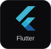
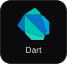
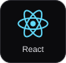
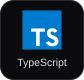
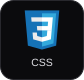
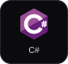
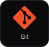

  

  
  
  
  

## Hey, I'm Andrei.

I'm an **Information Technology student at National University–Dasmariñas**, specializing in **Mobile and Web Applications**. I build practical mobile apps, responsive websites, and interactive experiences.

My work connects clear interfaces with APIs, databases, and useful workflows—from student services to fire-safety learning. I care about making each experience accessible, reliable, and easy to use.

**Open to internships, entry-level opportunities, and project collaborations.**

### Selected work

- **[IGNIS SAFE](https://andreiquias.vercel.app/projects/ignis-safe)** 
  Project manager and developer across the web platform, mobile learning app, and Unity fire-safety simulations. [Android releases](https://github.com/andreii2404/ignis-safe-mobile-releases)

- **[Rental by Maddy & Cassy](https://github.com/andreii2404/maddyandcassyrentals)** 
  Lead developer for a rental platform connecting product browsing, guided reservations, customer accounts, and administration.

- **[NU Freelance](https://github.com/andreii2404/NU_Freelance_Backup)** 
  Frontend development for a campus marketplace, including service listings, order management, and transaction-status views.

### Tech stack

**Mobile**

  
  

**Web**

  
  
  
  
  
  

**Interactive**

  
  

**Data & tools**

  
  
  
  

---

**Have something useful in mind? [Let's talk.](https://andreiquias.vercel.app/contact)** 
[Portfolio](https://andreiquias.vercel.app/) · [My journey](https://andreiquias.vercel.app/journey) · [Résumé](https://andreiquias.vercel.app/andrei-quias-resume.pdf)

Ideas, made useful. &nbsp; / &nbsp; Andrei Quias

