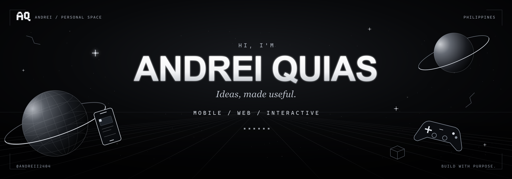

  

  
  
  
  

## Hey, I'm Andrei.

I'm an **Information Technology student at National University–Dasmariñas**, majoring in **Mobile and Web Applications**. I build practical apps, responsive websites, and interactive experiences that help people get things done.

I enjoy connecting thoughtful design with dependable systems—from a student marketplace to fire-safety learning. I'm currently improving my skills in **API integration, databases, and software architecture**.

**Open to internships, entry-level opportunities, and project collaborations.**

### Selected work

- **[IGNIS SAFE](https://andreiquias.vercel.app/projects/ignis-safe)** 
  A connected fire-safety platform with a public website, mobile learning, simulations, and admin tools. [Android releases](https://github.com/andreii2404/ignis-safe-mobile-releases)

- **[Rental by Maddy & Cassy](https://github.com/andreii2404/maddyandcassyrentals)** 
  A full-stack rental website with product browsing, guided reservations, and connected administration.

- **[NU Freelance](https://github.com/andreii2404/NU_Freelance_Backup)** 
  A service marketplace where NU Dasmariñas students can offer skills, discover work, and connect.

### My toolkit

**Mobile** · Flutter, Dart, React Native 
**Web** · React, Next.js, JavaScript, HTML, CSS 
**Interactive** · Unity, C# 
**Data & tools** · PostgreSQL, Supabase, Git, GitHub 
**Also working with** · Java

### A little more about how I work

- Start with what people need, then build a clear, accessible interface.
- Connect the UI, database, and APIs into something that works together.
- Test, listen to feedback, and keep improving.

---

**Have something useful in mind? [Let's talk.](https://andreiquias.vercel.app/contact)** 
[Portfolio](https://andreiquias.vercel.app/) · [My journey](https://andreiquias.vercel.app/journey) · [Résumé](https://andreiquias.vercel.app/andrei-quias-resume.pdf)

Ideas, made useful. &nbsp; / &nbsp; Andrei Quias

